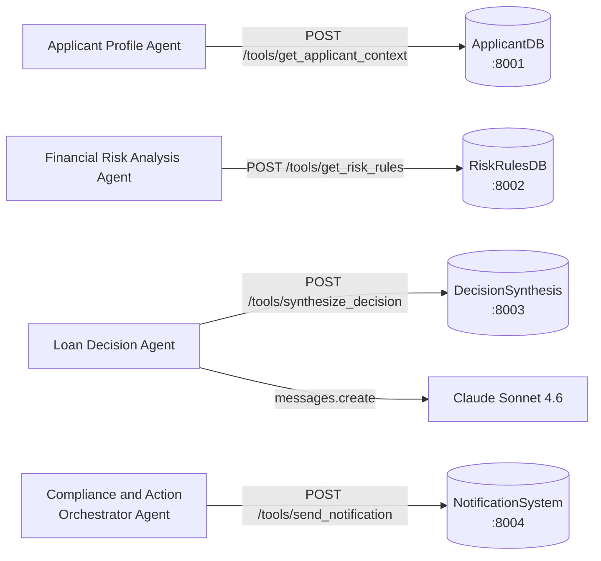

# Agent-to-MCP-Server Communication

## Agent Communication Map

## Agent Responsibilities

### Applicant Profile Agent
- **MCP Server:** ApplicantDB
- Fetches contextual applicant information from ApplicantDB
- Analyses the applicant profile
- **Output:** Income Stability Score, Employment Risk, Credit History Summary, Application Completeness Flags

### Financial Risk Analysis Agent
- **MCP Server:** RiskRulesDB
- Fetches configurable proof-of-concept risk rules from RiskRulesDB
- Analyses financial risk for the application
- **Output:** Debt-to-Income Ratio, Credit Score Risk Level, Loan Amount Risk, Anomaly Detection, Reasoning

### Loan Decision Agent
- **MCP Server:** DecisionSynthesis
- **LLM:** Anthropic Claude Sonnet 4.6
- Receives profile and risk outputs
- Calls DecisionSynthesis MCP for preliminary synthesis
- Invokes Claude for final structured decision
- **Output:** Classification, Risk Score, Confidence Level, Key Decision Factors, Explanation

### Compliance and Action Orchestrator Agent
- **MCP Server:** NotificationSystem
- Receives the loan decision
- Calls NotificationSystem MCP to simulate notifications and record actions
- **Output:** Action Taken, Notification Sent, Case ID, Timestamp, Summary
